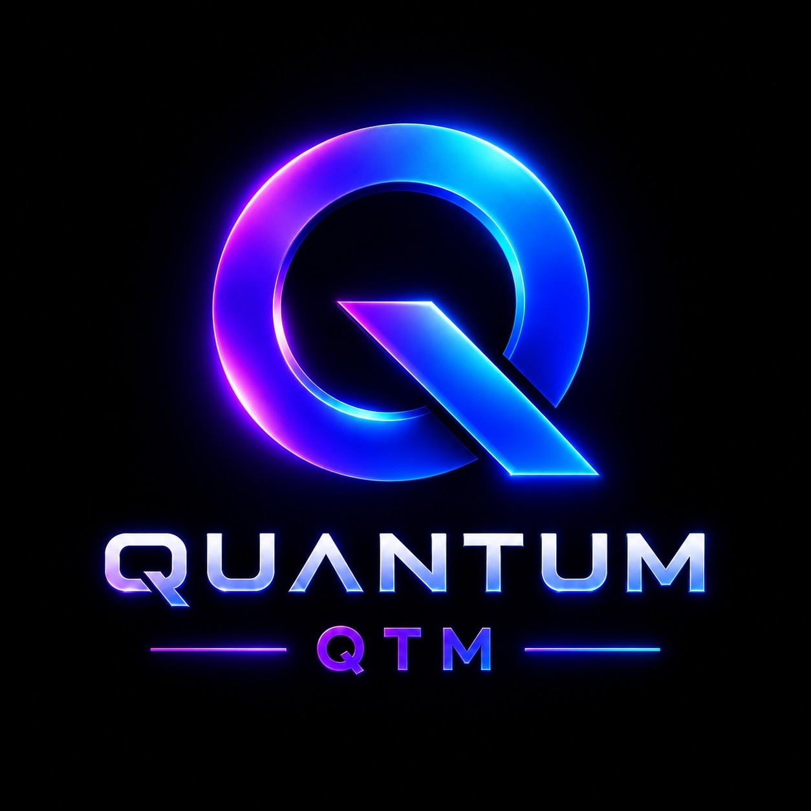

<p align="center">
  
</p>

<h1 align="center">Quantum (QTM)</h1>

<p align="center">
  Native Proof-of-Work Blockchain • Mainnet v1.0.0
</p>


---

# Overview

Quantum is an independent Layer-1 cryptocurrency with its own blockchain, written in C++ and powered by Proof of Work consensus.

The project focuses on decentralization, transparency, and long-term network stability.

## Features

- Native Quantum blockchain
- Proof of Work (PoW)
- Desktop Wallet (Windows)
- Blockchain Explorer
- Open-source codebase
- Public documentation
- MIT License

## Network Parameters

| Parameter | Value |
|-----------|-------|
| Project | Quantum |
| Ticker | **QTM** |
| Version | **1.0.0** |
| Consensus | Proof of Work |
| Genesis Reward | **350 QTM** |
| Block Reward | **50 QTM** |

## Repository Structure

```text
src/            Blockchain source
release/        Mainnet binaries
docs/           Documentation
press/          Press kit
installer/      Wallet installer
```

## Build

```bash
cmake -B build
cmake --build build
```

## Documentation

- WHITEPAPER.md
- TOKENOMICS.md
- ROADMAP.md
- SECURITY.md
- BRAND.md
- FAQ.md

## Official Resources

**Website**

https://officialqtm.github.io

**GitHub**

<https://github.com/officialqtm/quantum-blockchain>

**Explorer**

https://officialqtm.github.io/explorer.html

## Contact

**Official Email**

officialqtm@proton.me

## License

MIT License

---

© 2026 Quantum Foundation